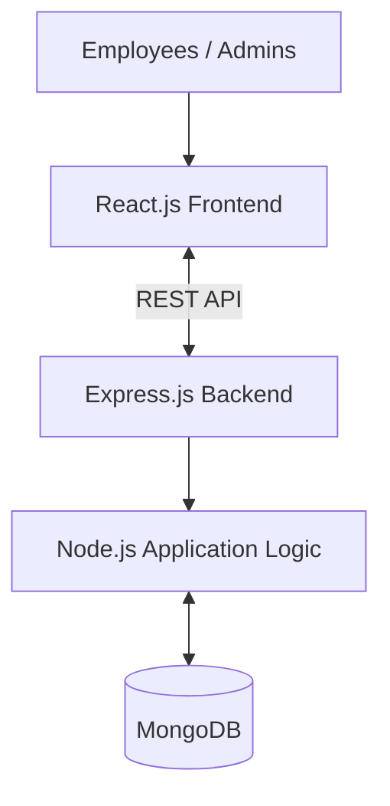

# ConnectNALCO — Employee & Operations Management Platform

A MERN-stack web application designed to centralize employee information, internal communication, announcements, and departmental activities at NALCO.

The project focuses on simplifying workplace collaboration through a unified platform with a responsive interface and a structured backend.

**Live Demo:** https://connectnalco.netlify.app/  
**GitHub:** https://github.com/Remanth05/connectNalco

## Tech Stack

- React.js
- JavaScript
- Node.js
- Express.js
- MongoDB
- REST APIs

## Core Features

- Employee profiles and management
- User authentication and role-based access
- Announcements and organizational updates
- Event management
- Department-level communication
- Responsive user interface

## System Architecture



## Local Setup

Clone the repository:

```bash
git clone https://github.com/Remanth05/connectNalco.git
cd connectNalco
```

Install dependencies in the frontend and backend directories:

```bash
npm install
```

Configure the required environment variables, including the MongoDB connection string and API configuration.

Start the frontend and backend using the npm scripts defined in their respective `package.json` files.

## Deployment

- **Frontend:** [Netlify](https://connectnalco.netlify.app/)
- **Source Code:** [GitHub Repository](https://github.com/Remanth05/connectNalco)

## Author

**Kuna Remanth Kumar**  
Computer Science and Engineering  
National Institute of Technology Patna (NIT Patna)

GitHub: https://github.com/Remanth05
